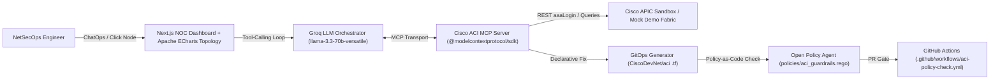

# ChatOps to GitOps — Zero-Trust Cisco ACI Policy Auditing & Remediation with Groq + MCP + OPA

A production-grade network security & automation platform that connects **Cisco DevNet's Always-On ACI Sandbox** (plus a deterministic **Zero-Trust Demo Fabric**) to a **Model Context Protocol (MCP)** server (`@modelcontextprotocol/sdk`), powered by **Groq** tool-calling inference (`llama-3.3-70b-versatile`), an interactive **Apache ECharts Force-Directed Topology Graph**, and a **GitOps Guardrail layer** (**Terraform `CiscoDevNet/aci`** + **Open Policy Agent `.rego`** + **GitHub Actions**) so AI never blindly mutates production network fabrics.

---

## Architecture Overview



---

## Key Capabilities

1. **Interactive Apache ECharts Force-Directed ACI Policy Graph:**
   - Visualizes `Tenant → VRF → EPGs → Contracts → Filters` in real time.
   - Policy violations (`vzAny`, wildcard filters, cleartext protocols, global scope leaks, unenforced VRFs) glow red with animated pulses.
   - **Click any node** in the graph to inspect its APIC Distinguished Name (`dn`), CIS Benchmark violation, and pre-fill or stage a one-click GitOps Terraform remediation.
2. **Model Context Protocol (MCP) Server (`src/mcp/server.ts` & `src/mcp/stdio.ts`):**
   - `list_tenants` — Queries APIC tenants, VRFs, Application Profiles, EPG counts, and health scores.
   - `get_fabric_health_and_faults` — Pulls active `faultInst` objects (`F0467`, `F1102`, `F1520`, etc.) and severity counts.
   - `audit_tenant_contracts` — Detects all 6 CIS Cisco ACI Benchmark violation categories:
     1. **`VZANY_EXPOSURE`** (`vzAny` any-to-any VRF contract bindings)
     2. **`WILDCARD_FILTER`** (`unspecified` protocol/ports or `1-65535`)
     3. **`CLEARTEXT_PROTOCOL`** (Telnet `TCP/23`, FTP `TCP/21`, HTTP `TCP/80`, SNMP `161`)
     4. **`CROSS_TENANT_LEAK`** (`scope = "global"` contracts risking cross-tenant export leakage)
     5. **`MISSING_SUBJECT`** (empty contracts with 0 subjects attached)
     6. **`UNENFORCED_VRF`** (`pcEnfPref = "unenforced"` on production VRFs)
   - `inspect_epg_relationships` — Maps EPG provider/consumer contract bindings and flags isolated EPGs.
   - `generate_gitops_remediation` — Writes declarative `CiscoDevNet/aci` Terraform HCL to `terraform/remediations/` and evaluates it against `policies/aci_guardrails.rego`.
3. **Side-by-Side GitOps Diff & Live OPA Rego Guardrail Viewer:**
   - Inspect generated Terraform HCL (`.tf`), side-by-side **Before vs. After APIC JSON state diff**, and individual Open Policy Agent rule verdicts inside the dashboard.

---

## Repository Structure

```text
.
├── .env.example
├── .gitignore
├── package.json
├── start.sh                              # Starts or restarts the application in the background
├── stop.sh                               # Cleanly stops the running application
├── src/
│   ├── lib/
│   │   ├── config.ts                     # Zod-validated environment configuration
│   │   ├── mock-fabric.ts                # Pre-seeded realistic ACI tenants, EPGs, contracts & faults
│   │   ├── aci-client.ts                 # Async Cisco APIC REST client (aaaLogin, live + mock fallback)
│   │   ├── gitops-generator.ts           # Terraform HCL generator & live OPA Rego policy evaluator
│   │   └── groq-agent.ts                 # Groq tool-calling orchestrator + MCP Client session
│   ├── mcp/
│   │   ├── server.ts                     # Official @modelcontextprotocol/sdk ACI Server & 5 tools
│   │   └── stdio.ts                      # Standalone MCP stdio transport entrypoint for Claude/Cursor
│   ├── components/
│   │   ├── AciTopologyChart.tsx          # Interactive Apache ECharts force-directed topology graph
│   │   └── GitOpsDiffViewer.tsx          # Terraform HCL, Before/After JSON Diff & OPA Verdict tabs
│   └── app/
│       ├── api/fabric/route.ts           # REST API for live/mock ACI topology & audit snapshot
│       ├── api/chat/route.ts             # REST API for Groq + MCP tool-calling & direct remediation
│       └── page.tsx                      # Main NOC/SOC Dark-Mode Dashboard
├── policies/
│   └── aci_guardrails.rego               # Open Policy Agent rules enforcing CIS Cisco ACI Benchmarks
├── terraform/
│   ├── providers.tf                      # CiscoDevNet/aci Terraform provider setup
│   └── remediations/                     # Output directory where the AI stages verified .tf plans
├── .github/workflows/
│   └── aci-policy-check.yml              # GitHub Actions CI running Vitest, terraform validate & conftest
└── tests/
    └── aci-audit.test.ts                 # Vitest suite testing ACI audit, MCP client/server & OPA rules
```

---

## Quick Start (`start.sh` & `stop.sh`)

### 1. Configure `.env`
Ensure `GROQ_API_KEY` is set in `.env` (already detected in your workspace). You can optionally customize parameters from `.env.example`.

### 2. Start (or Restart) the Application
```bash
./start.sh
```
- `start.sh` automatically checks if the server is already running on port `3300`, stops it if a restart is needed, installs dependencies if missing, and launches the dashboard at **`http://localhost:3300`**.

### 3. Stop the Application
```bash
./stop.sh
```

### 4. Run Automated Tests
```bash
npm test
```

### 5. Run as a Standalone MCP Stdio Server (Optional)
You can also connect Claude Desktop, Cursor, or any MCP host directly to the ACI MCP stdio server:
```bash
npm run mcp:stdio
```
